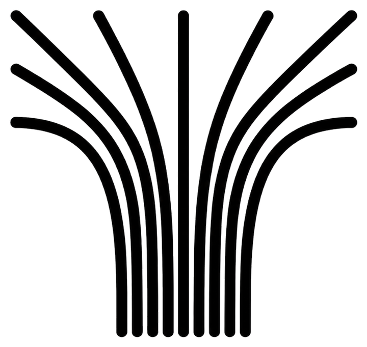
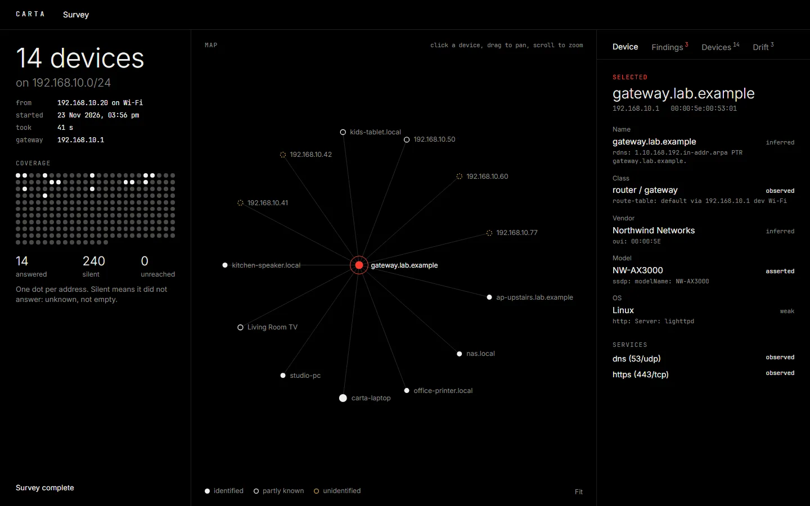
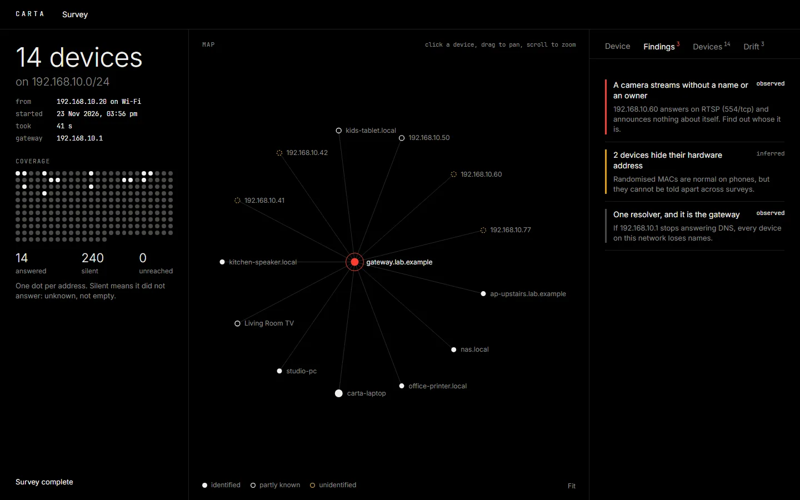
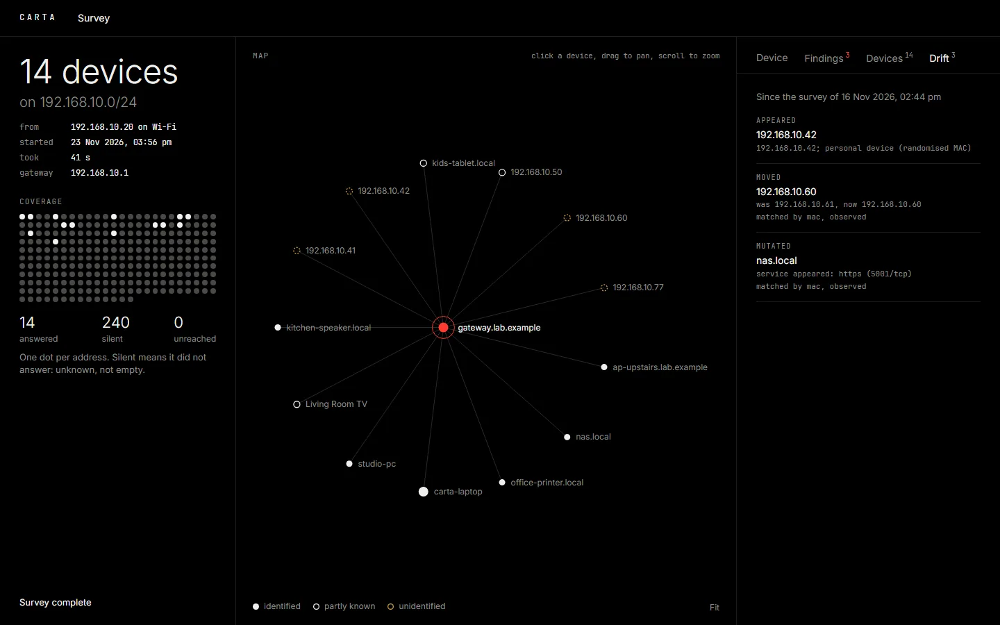
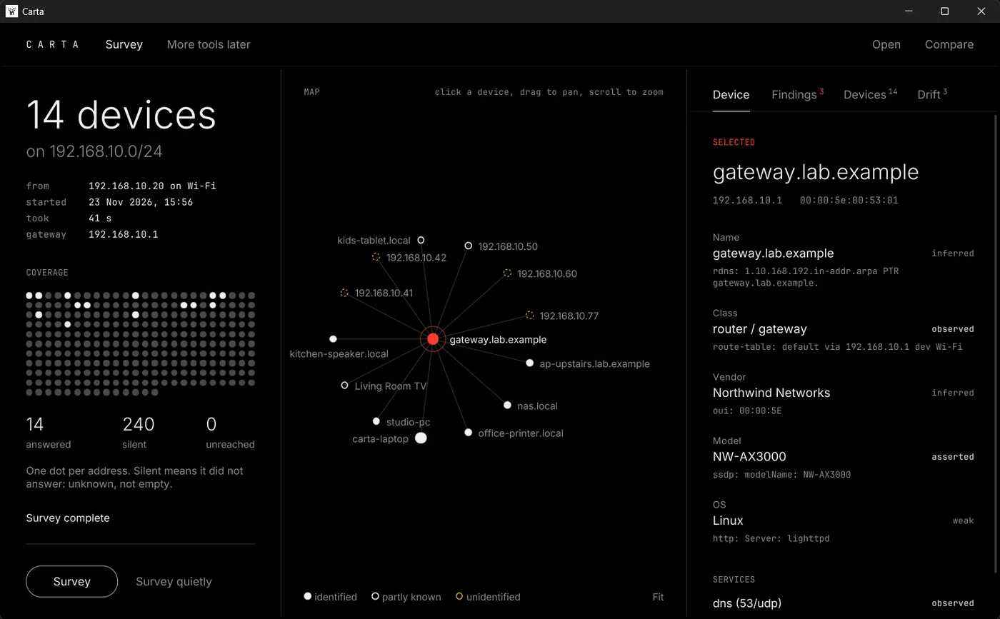
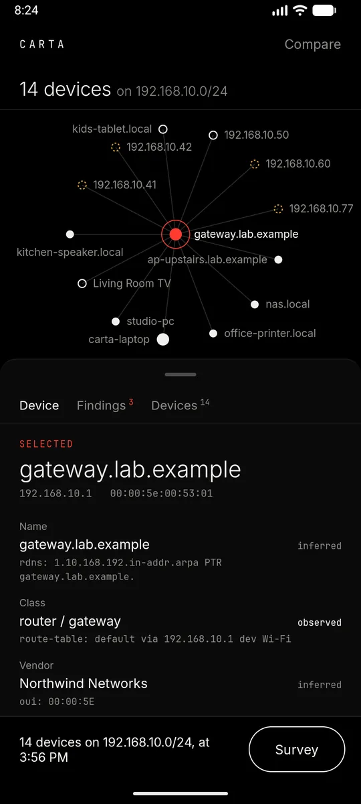
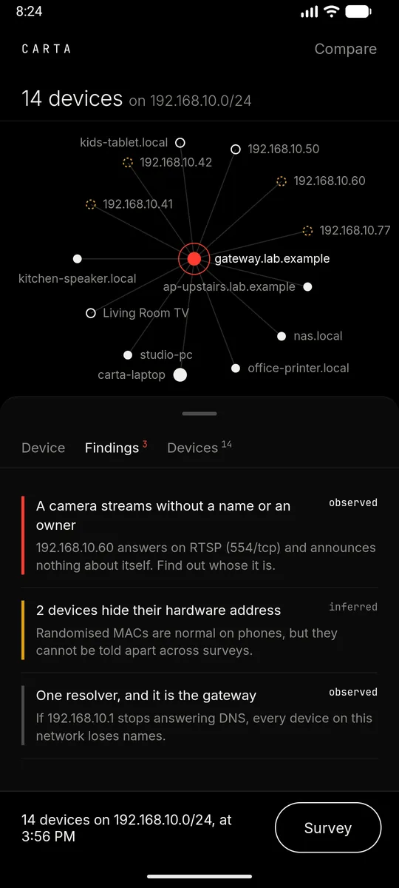

<p align="center">
  
</p>

<h1 align="center">carta</h1>

<p align="center">
  Plug into a network nobody has ever documented, and it documents itself —
  with the evidence for every claim attached, and the parts it could not reach
  drawn as blank space rather than guessed at.
</p>

---

Most networks are undocumented. The diagram on the wall is three years old, the
inventory spreadsheet drifted within weeks of being written, and the person who
built the addressing plan left in 2019. Every troubleshooting session, change
plan and audit begins with the same archaeology: reconstructing what the network
*is* from memory and guesswork.

`carta` is one command that does the archaeology for you:

```bash
carta survey
```

Thirty seconds later you have a device inventory, a topology diagram, an
addressing plan, a findings report, and a signed-in-place snapshot that the next
run diffs against. No installation, no agent, no credentials, no admin rights,
no internet. Or open **Carta Desktop**, the same survey in a window of its own,
or the Android app on a phone.

## The idea that makes this more than another scanner

A network map is not a picture. It is **a set of claims about the world**, and
those claims come from wildly different qualities of evidence:

| Claim | Evidence | How much you should trust it |
|---|---|---|
| `10.1.4.22` is alive | It completed a TCP handshake | **observed** — direct observation |
| `10.1.4.22` is a printer | It announced `_ipp._tcp` over mDNS | **asserted** — the device said so |
| `10.1.4.22` is a Dell | The OUI of its MAC address | **inferred** — prefixes get resold, VMs inherit them |
| `10.1.4.22` runs Linux | A TTL of 64 and an SSH banner | **weak** — trivially altered, frequently wrong |
| There is nothing at `10.1.4.47` | A sweep found no response | **This is not evidence of absence** |

Conventional discovery tools flatten all five into one confident-looking diagram
with identical boxes. A diagram that presents inference with the same authority
as observation is worse than no diagram, because engineers plan changes against
it and the parts that are wrong are indistinguishable from the parts that are
right.

So in `carta`, **confidence is carried on every single claim**, from the
observation that produced it through to the cell in the rendered table. It is
never averaged into a false probability, and a device that answered but revealed
nothing is reported as exactly that.

## What it produces

```
carta-surveys/20260920T041611Z/
├── README.md         as-built: the vantage, the coverage, the caveats
├── inventory.md      every device, what it is, how confident that is
├── inventory.csv     the same, for a spreadsheet
├── topology.mmd      the network as a Mermaid diagram
├── addressing.md     addressing, naming, occupancy, who serves what
├── findings.md       what is worth doing something about
├── provenance.md     every claim, its source, and every merge behind a device
├── drift.md          what changed since the last survey
├── survey.json       the snapshot the next run diffs against
└── survey.db         the same survey, queryable in SQLite
```

Two rows of an inventory, in the shape a real one comes out in:

| Address | MAC | Name | Vendor | Class | Services |
|---|---|---|---|---|---|
| `192.168.10.1` | `02:00:5e:10:00:01` | gateway.lab.example <sub>inferred</sub> | — | router <sub>inferred</sub> | https (443/tcp) |
| `192.168.10.31` | `7e:5d:c3:00:00:aa` | — | — | personal device (randomised MAC) <sub>weak</sub> | |

The second row is the point. It answered, it would not say what it is, its MAC
is randomised so no vendor can be inferred, and all of that is stated rather
than papered over.

## The browser view

```bash
carta ui
```

<p align="center">
  
</p>

Opens the survey on `127.0.0.1` — bound to loopback specifically, because a
survey document lists every device on a network and where its management
interface is, and serving that on `0.0.0.0` would publish the map of the network
to the network.

Shape carries certainty: a filled node is identified, an outlined node is partly
known, a dashed amber node answered and revealed nothing. Coverage is one dot per
address in the range: bright for an address that answered, grey for one that was
asked and stayed silent, and an empty ring for one it never asked (a quiet
survey asks nothing, and a survey stopped early leaves the rest of the range
unasked). Silent means unknown, not empty.

The findings tab is the same discipline applied to conclusions — each one states
how strongly it is held, and the coverage note says what was not reached:

<p align="center">
  
</p>

> The captures on this page are the real UI running against a synthetic snapshot of a
> fictional `192.168.10.0/24`. No real network appears in this repository, which
> is the same reason the tool writes its own output to a gitignored directory.

## Drift

Run it again next month:

```
Drift since the last survey: 2 appeared, 1 vanished, 1 moved.
```

The hard problem is identity across time, not comparison. A device whose DHCP
lease moved it from `.17` to `.43` has not appeared and vanished — it has
**moved** — and a report that says otherwise trains people to ignore it. Matching
runs on the most durable identity available (burned-in MAC, then hostname, then
address) and each match records which one it used. Randomised MAC addresses are
explicitly *not* used to match, because a phone regenerates one per network.

```bash
carta ui --compare carta-surveys/20261116T091400Z/survey.json
```

opens the latest survey with a Drift tab that lists each change and how it was
matched:

<p align="center">
  
</p>

## Carta Desktop

Carta in a window: one portable program, no browser, no server, nothing to
install. **Survey** and **Survey quietly** run the same engine as `carta survey`
and `carta survey --passive`, and each survey is saved, as the CLI saves one, in
a `carta-surveys` folder next to the program (or in your user config folder when
the program's own folder is read-only). It opens on the last survey. **Open**
reads any saved `survey.json`, and **Compare** picks an earlier survey of the
network and shows what changed. A selected device stays selected across a new
survey when it can be matched, and the panel says how strongly, or why it was
not seen this time.

<p align="center">
  
</p>

```bash
carta-desktop --demo   # a fictional network; sends nothing
```

It is built with [Fyne](https://fyne.io), which draws with OpenGL through cgo, so
building it needs a C compiler; the CLI never does. On Windows, double-click
`carta.bat` at the root of the repository: it builds the app with Go and MSYS2's
UCRT64 gcc and starts it. Elsewhere:

```bash
cd desktop
go build -o carta-desktop ./cmd/carta-desktop
```

On Linux that needs `gcc`, `libgl1-mesa-dev` and `xorg-dev`. `desktop/package.sh`
makes the release packages (`Carta.exe` with its icon and version, and
`Carta.tar.xz` for Linux).

## On a phone

`android/` is the Android app. It runs the same Go core as the CLI, bound with gomobile,
and shows the result in the same UI, laid out for a phone. A phone is a weaker instrument than a
laptop, and the app says so rather than hiding it:

- **No layer-2 evidence.** Android hides the ARP cache and other devices' MAC addresses from apps.
  So the app never confirms a device at layer 2 and never looks up a vendor from a MAC. Every
  survey's coverage and findings say this.
- **It refuses some networks.** It surveys only the Wi-Fi or Ethernet network it is attached to.
  It won't survey over a mobile carrier's network or while a VPN is on, because then it can't be
  sure which network its probes reach.
- **You pick the drift baseline.** Without MAC addresses or an SSID, Carta can't tell two networks
  apart reliably. Two homes on `192.168.1.0/24` look alike. So the operator chooses which earlier
  survey to compare against, and drift warns when the gateway, DHCP server, DNS servers or
  instrument differ.

<p align="center">
  
  &nbsp;
  
</p>

> The app running on an Android emulator against a synthetic survey of the same fictional
> `192.168.10.0/24` as the captures above, placed in the app's own storage. No real network was
> surveyed.

Releases are signed APKs on GitHub Releases, and [Obtainium](https://github.com/ImranR98/Obtainium)
installs and updates them on the phone. See [docs/RELEASING.md](docs/RELEASING.md) for releasing,
and [docs/DESIGN_SYSTEM_CARTA.md](docs/DESIGN_SYSTEM_CARTA.md) for the design system.

## Install

Each [release](https://github.com/Tanmay-Anand/Carta/releases) carries the CLI for Linux, macOS
and Windows (amd64 and arm64), Carta Desktop for Windows and Linux, the Android APK, and
`SHA256SUMS`. Every file is a single download with nothing to install alongside it; Carta Desktop
on Linux needs the system's OpenGL and X11 libraries, which a desktop install already has.

Or install the CLI with Go:

```bash
go install github.com/Tanmay-Anand/carta/cmd/carta@latest
```

Or build the single static binary:

```bash
CGO_ENABLED=0 go build -o carta ./cmd/carta
```

There is no runtime dependency. `CGO_ENABLED=0` cross-compiles to every target
from one host, which is the requirement for "runs on whatever machine is at the
site" — including a machine you are not allowed to install anything on.

## Usage

```
carta survey [flags]        survey the network this machine is on
carta diff A.json [B.json]  report what changed between two surveys
carta ui [SNAPSHOT.json]    open a survey in a browser
carta version
```

`carta survey` flags:

| Flag | Default | |
|---|---|---|
| `--out DIR` | `carta-surveys` | where the document pack is written |
| `--passive` | off | send nothing: this machine's own caches only |
| `--timeout DUR` | `700ms` | per-connection budget |
| `--concurrency N` | `128` | parallel workers |
| `--deadline DUR` | `4m` | hard limit on the whole survey |
| `--oui FILE` | built-in | an IEEE `oui.csv` for full vendor coverage |
| `--open` | off | open the browser view when the survey finishes |

`carta ui` flags:

| Flag | Default | |
|---|---|---|
| `--compare FILE` | none | an earlier survey; adds a Drift tab with what changed since |
| `--port N` | `7373` | the loopback port; `0` picks a free one |
| `--no-open` | off | serve the view without opening a browser |

## How it works

**Tier P — orientation, zero packets emitted.** Interfaces, routes, gateway,
DHCP lease, resolvers, Wi-Fi association, and the ARP cache as it stands before
anything is touched. It also records how the host is a *biased instrument*: a
VPN carrying the default route, a host firewall, a virtual switch, a system
proxy. Each one annotates the findings it affects, because "we found 14 hosts"
means nothing until you know where the instrument was standing.

**Tier 0 — unprivileged discovery.** Everything here works from an ordinary user
account on Windows, macOS and Linux:

- **ARP-cache warming** — touching an address at L3 forces the kernel to resolve
  it at L2, which is how an unprivileged process performs layer-2 discovery.
  L2 presence is far stronger evidence than any L3 response.
- **Multicast service discovery** — mDNS, SSDP/UPnP and NetBIOS in parallel.
  Collectively the richest unprivileged identity source on a modern network, and
  the one most scanners underuse: printers, speakers, NAS units and TVs all
  announce their own model number.
- **Risk-ranked TCP probing** — not "the top 1000 ports", but the ~35 that say
  what a device *is*, with banner capture, TLS certificate subjects and HTTP
  management-interface fingerprinting.
- **Reverse DNS** — and PTR coverage as a documentation-quality metric: a /24
  with four PTR records is a network nobody is administering by name.

**The model.** Every observation lands in one graph through a single entry
point, and entity resolution happens continuously via union-find over identity
keys (`mac:…`, `ip:…`, `host:…`). A device seen by ARP, by mDNS and by reverse
DNS becomes one device, every merge is recorded, and when two sources disagree
**both claims are kept**, the winner is demoted one level, and the disagreement
is printed.

Tier 1 (LLDP/CDP passive capture) and Tier 2 (SNMP topology crawl, switch-port
location) are designed but not implemented — see [Not implemented](#not-implemented).

## Scope and consent

Survey only networks you are authorised to survey. `carta` emits ordinary
unprivileged traffic — TCP connects, multicast queries, DNS lookups — but on a
managed network that is still activity someone may have to explain. `--passive`
sends nothing at all, not even a multicast question, and is the correct default
for OT, ICS and clinical networks. It sees only what this machine already knows:
the devices in its own ARP cache.

It refuses to sweep a prefix larger than a /22 rather than silently truncating
it, because a truncated sweep rendered as a complete one is the exact failure
this tool exists to prevent.

## Not implemented

Honest about its own coverage, since that is the whole point:

- **Tier 1** — LLDP/CDP, STP, VLAN observation, HSRP/VRRP. These need packet
  capture and elevation, which would break the "runs on a borrowed laptop"
  property; the design isolates them in a separate helper binary.
- **Tier 2** — SNMP `BRIDGE-MIB` crawl and switch-port location. Needs
  credentials.
- **Multi-vantage merge**, Ed25519-signed snapshots, IPv6 discovery beyond what
  the host already knows.
- The **built-in OUI table** covers the prefixes common on home and small-office
  networks. Pass `--oui` with the IEEE registry for full coverage.

## Tests

```bash
go test ./...
```

The Android binding and Carta Desktop are Go modules of their own, so the command above doesn't
reach them. Run their tests from `mobile/` and from `desktop/` (the desktop tests need the C
compiler, and run headless on Fyne's test driver):

```bash
go test ./...
```

`internal/store/snapshot/testdata/` holds surveys written in format 1, frozen: every future
Carta must still read, diff and render them.

The suite covers the confidence calculus and its promotion rules, entity
resolution and merge behaviour, snapshot determinism, drift matching across
address changes, Markdown injection from hostile device names, and a regression
test for a parser that once hung forever on an unhandled DNS record type.

## Version 1

Until Carta 2:

- **Surveys stay readable.** `survey.json` records its format (`"format": 1`). Every 1.x Carta
  reads every format 1 survey, including those written by 0.1.0, which predate the field. A
  survey written by a newer Carta is refused with a message, never half read.
- **The CLI stays put.** The commands and flags under [Usage](#usage) keep working as documented;
  new ones may be added.
- **Android updates install over the app.** Every release is signed with the same key, so an
  update keeps the surveys on the phone.

A change that would break one of these waits for Carta 2.

## Licence

MIT.
